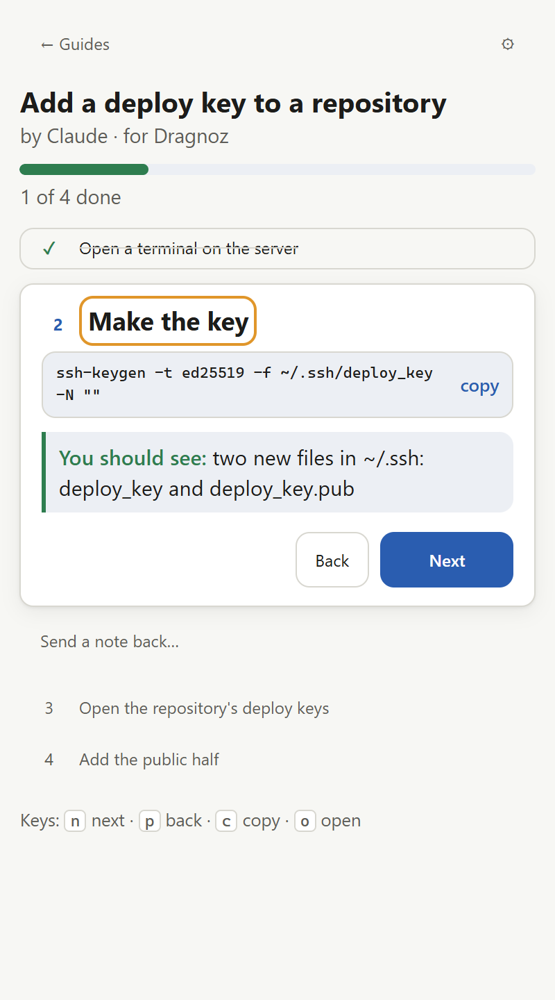
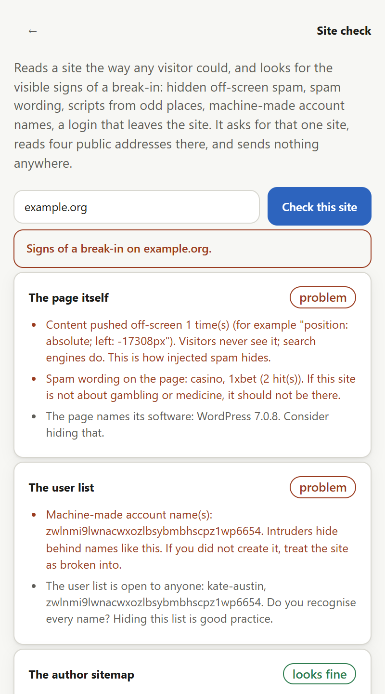
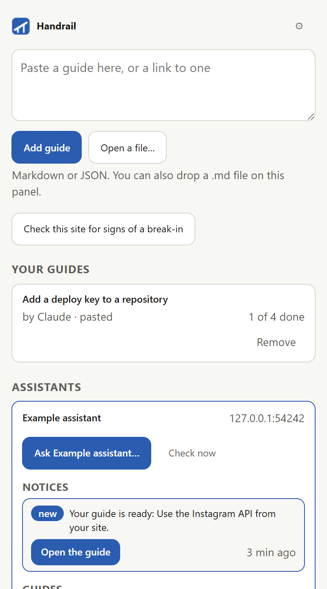

# Handrail

A step-by-step guide at the side of the page you are working on.

When you have to do something complex on the web, the instructions live in one window and the work in another. Handrail puts the guide in a drawer beside the page: one step at a time, a value to copy with one click, links that open under the drawer, and a quiet "you seem to be on step 6, jump?" when you land on the page a later step is about.



It is not an assistant and not an automation tool. The guide is written elsewhere, by a person or by an assistant of your choosing. Handrail is the rail you hold while you walk it. There is no account, no server and no telemetry. Nothing leaves the browser except what you send, when you press Send.

## Install

Get the build: download the latest `handrail-chrome` or `handrail-firefox` zip from the Actions tab (sign in to GitHub to see them), or build both with `pnpm install && pnpm build` (`dist/` for Chrome, `dist-firefox/` for Firefox). Firefox loads the zip as it is; for Chrome, unpack it first.

**Chrome**

1. Open `chrome://extensions`, turn on **Developer mode**, press **Load unpacked** and choose the `dist` folder.
2. Press the Handrail button in the toolbar. The drawer opens at the side.

**Firefox** (142 or newer)

1. Open `about:debugging#/runtime/this-firefox`, press **Load Temporary Add-on…** and choose the downloaded `handrail-firefox.zip`, or `manifest.json` inside the `dist-firefox` folder. A temporary add-on is gone when Firefox closes; a signed build that stays comes with the store listing in 0.4.
2. Press the Handrail button in the toolbar, or open the sidebar (`Ctrl+B` / `Cmd+B` shows sidebars; pick Handrail). The drawer opens at the side.

Stores come in 0.4.

## Use

- **Add a guide**: paste its text into the box at the top, or paste a link to a `.md` file (Handrail asks for that one site), or open a file, or drop a `.md` on the panel.
- **Walk it**: the open step shows its title, body, chips for values to copy, what you should see, and a picture. **Next**, **Back**, **Skip** on optional steps, **Done** on the last. Done steps fold to a ticked line; click one to reopen it.
- **Keys**: `n` next, `p` back, `c` copy the first value, `o` open the step's address here.
- **Open here**: a link in a step, or the step's address, opens in the tab you are on. Never a new window.
- **Where am I**: when the tab you are on matches a later step's address, the drawer offers a jump. It never jumps by itself.
- **Check this site**: a button on Home reads the site you are on (or any address you type) for the visible signs of a break-in: hidden off-screen spam, spam wording, scripts from odd places, machine-made account names, a login that leaves the site. A bad result offers a cleanup guide written for that site, and a report of the findings written for the reader you pick — a general overview, the admin, your agency, the host — to copy, save or email. It runs only when you press it, asks for that one site, and sends nothing anywhere by itself.
- **Send a note back**: under every step. It goes to one place you chose in Settings: the clipboard, a file, your mail program, a webhook or an assistant. Text that looks like a key or a password is refused.
- **Settings**: assistants, where notes go, text size, what you sent, export and import everything as one JSON file, remove everything.



## Assistants

An assistant is any place that writes guides for you: a tool of your own, a team's server, a help desk, a folder of files on a web host. You add it once, in Settings, with one address and, if it wants one, a key. Then:

- its **guides** are listed in the drawer, newest first, and open with one press;
- when you land on a page one of them is about, the drawer says **"There is a guide for this page"** and offers it;
- you can **ask** it for a guide: say what you want to do, in a sentence or two, and the guide shows up in the list when it is written;
- your **notes back** can go to it;
- its **notices** show in the drawer, with a count on the toolbar button until you look.



Handrail reads an assistant's lists when the drawer opens and every five minutes. It sends something only when you press Send, and only to that assistant. Its key is kept in the browser, sent to its own address only, and never exported.

Anyone can be an assistant. The whole contract is one short document, [docs/assistant.md](docs/assistant.md), and [examples/](examples/) holds two: a folder of static files, and a hundred-line Node script that turns a folder into an assistant that takes asks and notes. Handrail knows nothing about any one assistant; the contract and the guide format are the only coupling.

## The guide format

A guide is Markdown. Steps are the `## ` headings (or a numbered list). Fields sit in an indented block right under a step.

```markdown
---
title: Add a deploy key to a repository
id: add-deploy-key
for: Dragnoz
---

## 1. Open a terminal on the server
Not on your own computer: the key belongs to the server.

## 2. Make the key
    copy: ssh-keygen -t ed25519 -f ~/.ssh/deploy_key -N ""
    expect: two new files in ~/.ssh: deploy_key and deploy_key.pub

## 3. Add the public half
    url: https://git.example.org/*/settings/keys
In the repository: Settings, Deploy keys, Add deploy key.
```

| field | meaning |
|---|---|
| `url:` | where the step happens; `*` matches anything. Used for "where am I" and "open here". |
| `copy:` | a value to copy with one click. Never run. |
| `expect:` | what you should see when the step is done. |
| `image:` | a picture (address or data URI). |
| `note:` | the hint shown in the notes box at that step. |
| `optional: true` | the step may be skipped. |
| `target:` | for 0.5 (pointing at the page). |

The whole contract, with the JSON form, is in [docs/guide-format.md](docs/guide-format.md). Example guides are in [guides/](guides/): a practice walk through the drawer, one that teaches you to write a guide, one that connects an assistant, and the one above.

## Permissions, and why

| permission | why |
|---|---|
| `storage` | your guides, progress, assistants and settings stay in the browser |
| `sidePanel` (Chrome) | the drawer. Firefox uses its sidebar for this and needs no permission. |
| `tabs` | the address and title of the tab you are on, for "where am I", "open here", the offer of a guide for the page, and the page an ask or a note carries when you tick it. Chrome words this as "read your browsing history", Firefox as "access browser tabs"; Handrail reads the active tab's address and records nothing. |
| `alarms` | the background reads the assistants' lists every five minutes, for the count on the button |
| one site, when you add a guide by link, an assistant by address, or check a site | reaching that site; asked for at that moment, for that site only |

No `<all_urls>`, no content scripts yet, no remote code, no data collected.

## Develop

```
pnpm install
pnpm build          # dist/ (Chrome) and dist-firefox/ (Firefox)
pnpm test           # parser, matcher and the assistant contract, against the docs
pnpm test:e2e       # the drawer in Chromium, with a local assistant
pnpm lint:firefox   # web-ext lint on the Firefox build
pnpm screenshot     # README pictures
pnpm zip            # release/handrail-<browser>-<version>.zip
```

See [CONTRIBUTING.md](CONTRIBUTING.md) for the layout and the rules. Every change is one line in [CHANGELOG.md](CHANGELOG.md).

## Roadmap

| version | brings |
|---|---|
| 0.1 | Chrome side panel; paste, link and file guides; the parser; one step at a time; chips; keys; open here; where am I; export and import. 0.1.1 added the Firefox sidebar from the same code |
| 0.2 | Assistants: guides lists, asks, notes back, notices, the count on the button; the contract and two examples |
| 0.3 | Site check: the visible signs of a break-in on the site you are on, and a cleanup guide written for that site |
| 0.4 | Store listings, docs, signed builds |
| 0.5 | Pointing at the page: outline the button a step names, per-site permission |

## Licence

MIT. See [LICENSE](LICENSE).
